# Connector Foundry

Printable mounting interfaces — Gridfinity, openGrid, Honeycomb Storage Wall, Skådis, MOLLE, MOD-GRID,
GoPro, Arca-style plates and tripod threads, DeckMate, BitBeam, 2020 extrusion — as parametric OpenSCAD
parts that share one slot convention, so any of them can be combined with any other. Export a
single part as STL, or compose several in the browser and export the result.

**Website: [dnnsmnstrr.github.io/connector-foundry](https://dnnsmnstrr.github.io/connector-foundry/)**
— what it does, the parts, the downloads and the guides. New here? Start with
[Getting started](docs/GETTING_STARTED.md).

Three ways to get a part from the same `.scad` sources:

- **Browser app** ([open it](https://dnnsmnstrr.github.io/connector-foundry/app/); source in
  `web/`) — pick a part, set parameters, preview, export STL; combine parts on the Bench. Runs
  entirely client-side via `openscad-wasm`. The primary way to use this, also as a
  [desktop app](docs/DESKTOP.md) for macOS and Windows. As in TinkerCAD, the selected part has
  square handles to drag to a new size, or click to type one (on the Bench, the base part; in the
  Holes tab, a cutout); Cmd/Ctrl+Z undoes in every tab, and `?` lists every shortcut. The 3D
  view's **Helpers** button (or `H`) hides the grid, slot markers, hole outlines, guides and
  handles to show just the model.
- **CLI** (`cli/foundry.py`) — `foundry render gridfinity/base --gx 2 --magnets -o out/`; see
  [the command line guide](docs/CLI.md).
- **OpenSCAD** — open anything under `parts/` or `assemblies/` in the GUI.

## Where the geometry comes from

Where a standard has a reference implementation, this repo calls it instead of re-deriving it.
Those upstreams are vendored under `vendor/` and the files in `parts/` are thin wrappers that add
only the slot convention:

| Upstream | Licence | Used by |
| --- | --- | --- |
| [BOSL2](https://github.com/BelfrySCAD/BOSL2) | MIT | everything (attachments) |
| [gridfinity-rebuilt-openscad](https://github.com/kennetek/gridfinity-rebuilt-openscad) | MIT | `gridfinity/base`, `gridfinity/bin`, `gridfinity/baseplate` |
| [GoProScad](https://github.com/ridercz/GoProScad) | MIT | `gopro/*` |
| [QuackWorks](https://github.com/AndyLevesque/QuackWorks) | CC-BY-NC-SA 4.0 | `opengrid/board`, `opengrid/snap` |
| [openGrid-projects](https://github.com/mitufy/opengrid-projects) | CC-BY 4.0 | `opengrid/openconnect`, `opengrid/multiconnect`, the Holes tab's openConnect slot and openGrid thread |
| [3d-scad-hsw-customizable](https://github.com/geru/3d-scad-hsw-customizable) | CC-BY 4.0 | `hsw/wall` |
| [3d-scad-hsw-clip](https://github.com/geru/3d-scad-hsw-clip) | MIT | `hsw/insert` |
| [bitbeam-lib](https://github.com/ondratu/bitbeam-lib) | BSD-3-Clause | `bitbeam/beam`, `bitbeam/plate` |
| [technic.scad](https://github.com/cfinke/technic.scad) | MIT | `bitbeam/pin`, `bitbeam/axle` |
| [AluminumExtrusionProfile](https://github.com/ServerNinja/OpenSCAD_AluminumExtrusionProfile_Library) | Apache-2.0 | `extrusion2020/rail` |
| [Mechanism](https://getmechanism.com/pages/digital-files) (STL files; the Adhesive Puck from [their Printables account](https://www.printables.com/model/1337452-mechanismdeckmate-adhesive-puck)) | CC BY-NC 4.0 | `deckmate/*` |

The 2020 fittings are modelled here from dimensions measured off
[NopSCADlib](https://github.com/nophead/NopSCADlib)'s E2020t (GPL, so measured against, never
vendored). Specifications consulted: [gridfinity.xyz](https://gridfinity.xyz/specification/),
[opengrid.world](https://www.opengrid.world/guides/board/), [bitbeam.cc](https://bitbeam.cc/). The
MultiConnect head and slot (`lib/multiconnect.scad`) are modelled here from the published numbers —
openGrid-projects' head, QuackWorks' slot profile — since no permissively licensed implementation
exists to vendor. The Skådis slot, pattern and hook tab (`lib/skadis.scad`) are this repo's
too, for the same reason: the community's Skådis libraries are GPL or unlicensed, and
[parametric-skadis-tower](https://github.com/breckenedge/parametric-skadis-tower) (CC-BY-SA) is
measured against, not vendored. The MOLLE spine, panels and insert (`lib/molle.scad`) are this repo's
from scratch: PALS is defined by its webbing (25.4 mm rows, 25.4 mm apart, bar-tacked every
38.1 mm), rigid panels have no standard at all, and there is no open model to check against, so all are
`parametric`. The MOD-GRID grid and bit holders (`lib/modgrid.scad`) are rebuilt here from
measurements of the designer's own STLs, which sit behind a MakerWorld login: they are not shipped,
and `references.yaml` checks the parts against them once they are in `refs/manual/modgrid/`. The
pin keeps the designer's layout but is reshaped so its legs bend instead of snapping off, and is
checked to fit the designer's grid.
Each catalogue entry links its own source; see "Licensing" for what the non-MIT ones mean for you.

## Quick start

```bash
git clone --recurse-submodules <repo-url>
cd connector-foundry
python3 -m venv .venv && .venv/bin/pip install -e ".[dev]"
.venv/bin/python cli/foundry.py list
.venv/bin/python cli/foundry.py render gridfinity/base --gx 2 --magnets -o out/
.venv/bin/python -m pytest tests/
```

The CLI needs an OpenSCAD development snapshot; [the command line guide](docs/CLI.md) says where
to get one and how to point `foundry` at it.

Web app: `cd web && npm install && npm run dev`. No local OpenSCAD needed — it compiles the same
sources in a Web Worker. The dev server opens on the website's landing page; the app is at
`/app/` and the guides at `/docs/`. See `web/README.md` for the internals. Already cloned without
submodules? `git submodule update --init --recursive`.

Desktop app ([installing it](docs/DESKTOP.md)): download it for
[Apple Silicon](https://github.com/dnnsmnstrr/connector-foundry/releases/latest/download/Connector-Foundry-mac-apple-silicon.dmg)
or [Intel](https://github.com/dnnsmnstrr/connector-foundry/releases/latest/download/Connector-Foundry-mac-intel.dmg)
Macs, or the Windows installer for
[x64](https://github.com/dnnsmnstrr/connector-foundry/releases/latest/download/Connector-Foundry-windows-x64-setup.exe)
or [ARM](https://github.com/dnnsmnstrr/connector-foundry/releases/latest/download/Connector-Foundry-windows-arm64-setup.exe)
PCs (all versions: [releases](https://github.com/dnnsmnstrr/connector-foundry/releases)),
or run it from source with `cd web && npm ci && npm run desktop`. `npm run desktop:dist` builds the
app for the machine it runs on: a `.app`, DMG and ZIP on a Mac, an installer on Windows (and
`npm run desktop:dist -- --win --x64` builds that installer from a Mac). Native Open/Save dialogs
support STL and bench config files. On a Mac, build and install (or update) the app with
`npm run desktop:install` from `web/`. See [macOS packaging and runtime evaluation](docs/MACOS.md)
and [the Windows build](docs/WINDOWS.md).

## Slot convention

- A part's functional face is its **BOTTOM**, which is also its print orientation.
- The default mount point is a named anchor `"mount"` on **TOP**; larger parts add a
  `mount_<i>_<j>` grid, and parts with more faces add `bot`, `xpos`, `xneg`, `ypos`, `yneg`.
- Attaching through a slot spends it.

Physical constants live in `lib/constants.scad`, or upstream where the geometry is vendored (a
duplicated constant can drift; the few that must be restated are checked). Two are global
settings: printer fit tolerance, `FIT_CLEARANCE`, and how finely curves are faceted,
`CIRCLE_DETAIL` (`draft`, `normal` or `fine`). At `normal` every part renders with the detail it
was written for (Gridfinity and the openGrid connectors with their upstream generators' own
settings); `draft` doubles the facet size for faster renders, `fine` halves it for rounder holes.

## Joints

`lib/joints.scad` mates two parts through their mount slots in five ways: fused, bolted, snap, pin
and screwed. What each one is, and what it exports: [docs/JOINTS.md](docs/JOINTS.md).

## Bench

The web app's Bench tab is a visual editor: pick a base part, click a slot marker, attach a part
with a joint, repeat. Its controls, resizing the base part, undo, STL/STEP/3MF import, export
naming, configs and presets: [docs/BENCH.md](docs/BENCH.md).

## Holes

The web app's Holes tab puts screw holes, connector slots and cutouts into a model: a catalogue
part, a mesh of your own or the bench as it stands. The snap points, resizing and moving holes,
every preset group and the print options: [docs/HOLES.md](docs/HOLES.md).

## Catalogue

`catalogue.yaml` is the single source of truth: id, system, module, defaults, confidence, source,
print note. The CLI, the tests, the web app and the table below are generated from it (`foundry
readme` after adding a part). Confidence:

- `exact` — from a reference implementation or a published spec, and checked in `references.yaml`
  (or the `source` field says why there is nothing to check against).
- `parametric` — a starting point; verify against your hardware.
- `imported` — Bench-only, for a mesh you brought in.

The BitBeam pin and axle exist for the pin joint and the CLI but are hidden from the part lists:
LEGO-compatible fasteners print poorly, so print real ones or use the finished BitBeam parts.

<!-- CATALOGUE:START -->
| Part | System | Confidence | Licence | Source | Print note |
| --- | --- | --- | --- | --- | --- |
| 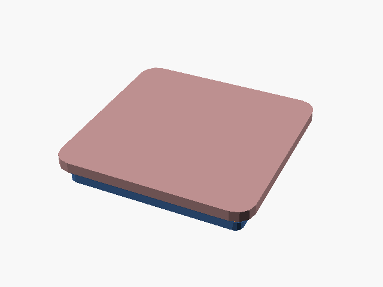<br>Bin base | Gridfinity | exact | MIT | [gridfinity-rebuilt-openscad (kennetek, MIT), vendored](https://github.com/kennetek/gridfinity-rebuilt-openscad) | Feet down, no supports. |
| 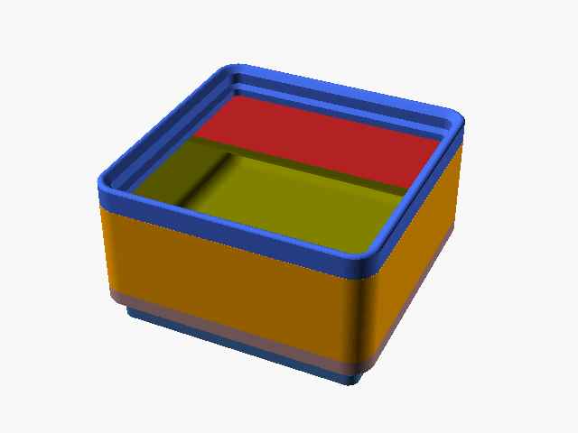<br>Bin | Gridfinity | exact | MIT | [gridfinity-rebuilt-openscad (kennetek, MIT), vendored — its bin generator's new_bin()/bin_render()](https://github.com/kennetek/gridfinity-rebuilt-openscad) | Feet down, no supports. gz is the height in 7mm units, the stacking lip on top. filled makes it solid up to the lip, with a flat top to cut your own cavities into in the Holes tab; divx/divy, scoop and tabs apply to a bin with compartments. |
| 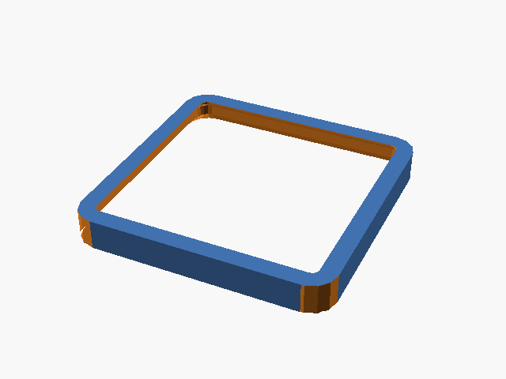<br>Baseplate | Gridfinity | exact | MIT | [gridfinity-rebuilt-openscad (kennetek, MIT), vendored](https://github.com/kennetek/gridfinity-rebuilt-openscad) | Modelled pockets down so the flat back is the "mount" face; flip it in the slicer to print back-down. Magnets and screw holes only apply to the weighted, skeletonized and screw-together styles. |
| 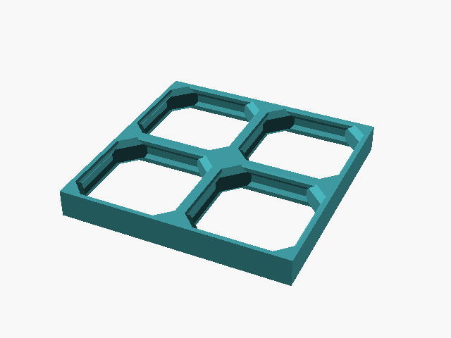<br>Board | openGrid | exact | CC-BY-NC-SA-4.0 | [QuackWorks openGrid.scad (openGrid by David D, OpenSCAD by BlackjackDuck), vendored. CC-BY-NC-SA — see README "Licensing".](https://github.com/AndyLevesque/QuackWorks) | Grid face up, flat on the bed. A board is exactly cells x 28mm with no border, so boards butt together. lite is 4mm, full 6.8mm, heavy 13.8mm (two halves back to back, with a sealed cavity per cell). |
| 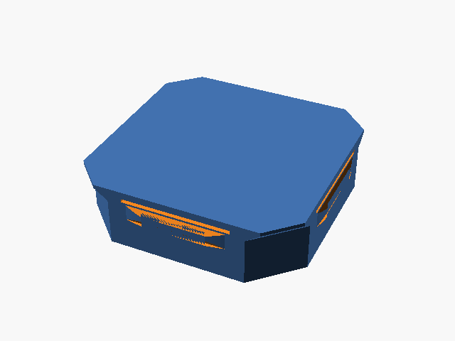<br>Snap | openGrid | exact | CC-BY-NC-SA-4.0 | [QuackWorks opengrid-snap.scad (openGrid by David D, snap by metasyntactic), vendored. CC-BY-NC-SA — see README "Licensing".](https://github.com/AndyLevesque/QuackWorks) | Print in PETG or another filament with some flex so the wings can compress; no supports. The lite snap is half height (3.4mm), which is not the same as a lite board. |
| 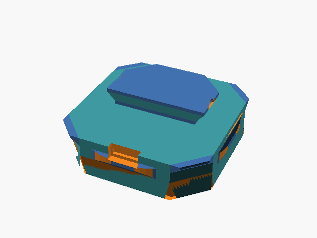<br>openConnect snap | openGrid | exact | CC-BY-4.0 | [openGrid-projects (mitufy, CC-BY 4.0), vendored — its snap body and openConnect head, as its parametric snap generator renders them (text label off).](https://github.com/mitufy/opengrid-projects) | Snap on the bed, head up; no supports (the head's taper is 45°). Goes into any openGrid board cell; anything with an openConnect slot (Holes tab) or a MultiConnect slot hangs on it. The lite snap is half height (3.4mm) for lite boards. directional is the body for a wall-mounted board — its deeper back nub takes the load — symmetric for a horizontal one. body none is the head alone, for fusing onto another part (the Bench's default when attaching it). body screw is the head on openGrid's 16mm snap thread instead of a snap (upstream's openConnect screw): print it thread down, then screw it into a threaded openGrid snap or into the openGrid thread the Holes tab cuts, turning it by the coin slot in its face. Screwed home, the head points the way a snap's does. variant picks the thread length (full 6.8mm, lite 3.4mm). |
| 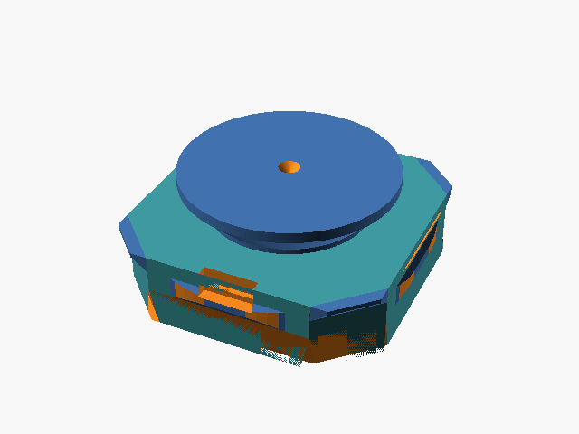<br>MultiConnect snap | openGrid | exact | CC-BY-4.0 | [openGrid-projects (mitufy, CC-BY 4.0), vendored, for the snap body; the MultiConnect head is this repo's own, from the published numbers (lib/constants.scad), checked against the head that generator renders.](https://github.com/mitufy/opengrid-projects) | Snap on the bed, head up; no supports. Hangs any Multiboard accessory — or anything with a MultiConnect slot from the Holes tab — off an openGrid board. variant and body as for the openConnect snap, body none being the head alone for fusing onto another part, body screw the head on openGrid's snap thread (a coin slot across the disc instead of the dimple). |
| 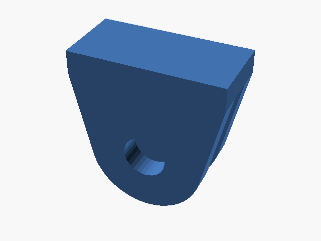<br>Two-prong male buckle | GoPro | exact | MIT | [GoProScad (ridercz, MIT), vendored](https://github.com/ridercz/GoProScad) | Legs down; use a brim. Mates with any GoPro three-prong buckle. leg_dia is the round leg ends' diameter: the standard 15, from 14 to 20 for a little less or more material around the bolt; over 17, raise leg_h to at least leg_dia so a mating buckle clears the plate. |
| 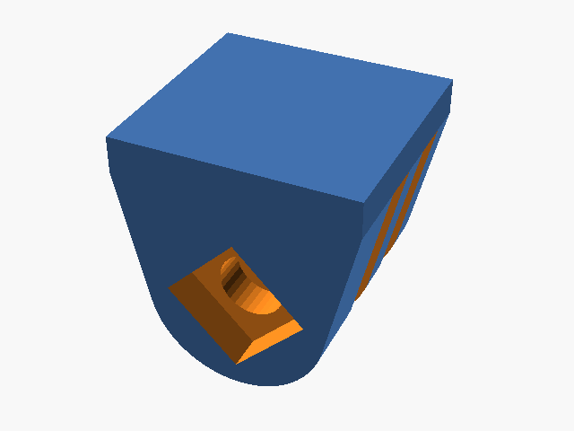<br>Three-prong female buckle | GoPro | exact | MIT | [GoProScad (ridercz, MIT), vendored](https://github.com/ridercz/GoProScad) | Legs down; use a brim. outer_w is the far outer leg's width: the standard 3mm leg plus a captive pocket for an M5 hex nut in the rest. 3 makes all three prongs the same width, with a plain through-hole and no pocket. nut_sides 4 with nut_dia 11.5 takes a square nut instead. A far leg wider than the near one runs the plate further to that side; "mount" sits over the middle prong regardless. symmetric pads the near leg to outer_w too, for a plate centred on the prongs. leg_dia is the round leg ends' diameter: the standard 15, from 14 to 20 for a little less or more material around the bolt; over 17, raise leg_h to at least leg_dia so a mating buckle clears the plate. |
| 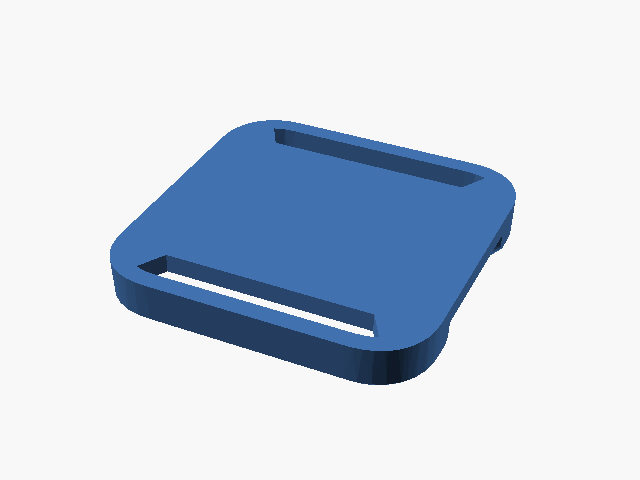<br>Innie | DeckMate / Mechanism | exact | CC-BY-NC-4.0 | [Mechanism's Universal Grip STL — the manufacturer's own model, imported unmodified. CC BY-NC 4.0 — see README "Licensing".](https://getmechanism.com/pages/digital-files) | The socket half. Flat back up as "mount" (where Mechanism puts the adhesive); the socket side has undercuts, so flip it in the slicer. "bot" sits over the socket recess, not on material. |
| 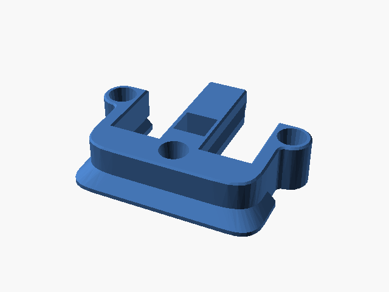<br>Outie | DeckMate / Mechanism | exact | CC-BY-NC-4.0 | [Mechanism's Bot Print STL — the manufacturer's own model, imported unmodified; slim is cut from Mechanism's Adhesive Puck STL (printables.com/model/1337452, also unmodified). CC BY-NC 4.0 — see README "Licensing".](https://getmechanism.com/pages/digital-files) | The rail half; slides into an Innie. Base up as "mount". Fuse it, or use the screwed joint on its three-hole pattern and print the rail on its own, rail up. fill_holes plugs the holes on a fused one. slim is Mechanism's own slim Outie, from its Adhesive Puck: no ears for the side holes and the U's outer edge brought in, 30.6mm wide instead of 35.3mm, holes solid — for fusing onto something, not for the screwed joint. |
| 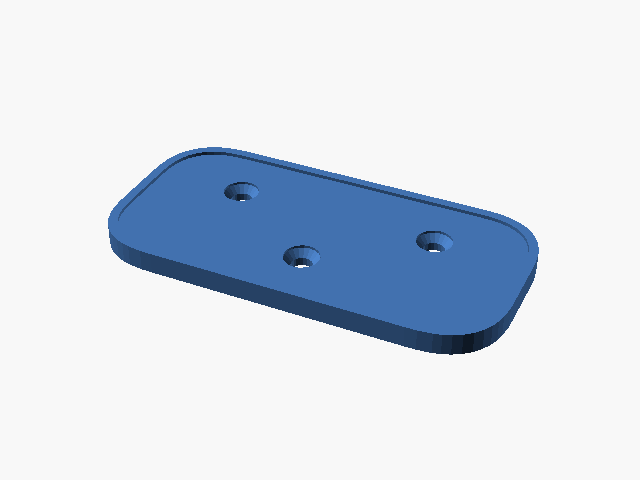<br>Universal base | DeckMate / Mechanism | exact | CC-BY-NC-4.0 | [Mechanism's Deck Mate Universal STL — the manufacturer's own model, imported unmodified. CC BY-NC 4.0 — see README "Licensing".](https://getmechanism.com/pages/digital-files) | Mechanism's 56.7 x 28.4 x 3mm base plate: hole pattern down as "bot", adhesive face up as "mount". Stack an Outie on "bot" with the screwed joint (no flange needed). Prints flat either way up. |
| 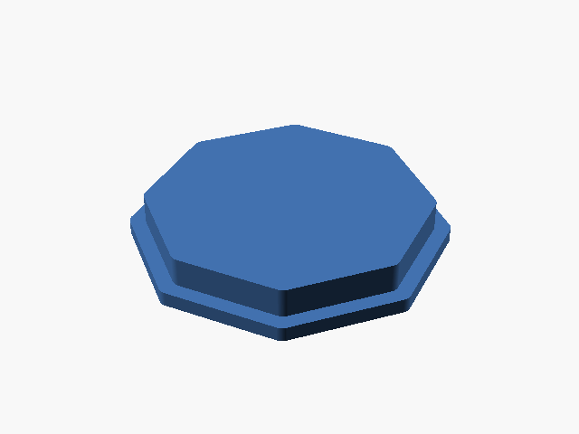<br>Base | KLIPPT | exact | CC-BY-SA-4.0 | [KLIPPT by FH (printables.com/@bequ3) — the designer's own base models (the base STEP, tessellated; the screw base STL), imported unmodified. CC BY-SA 4.0 — see README "Licensing".](https://www.printables.com/model/424351-klippt-locking-cable-clip) | Flange on the bed, no supports. A KLIPPT clip slides on from the side, its lips under the 20mm flange, gripping the 18mm neck. The neck's flat face is "mount": stick or fuse it onto a part, or with screw use the countersunk hole (head on the flange side, under the clip). |
| 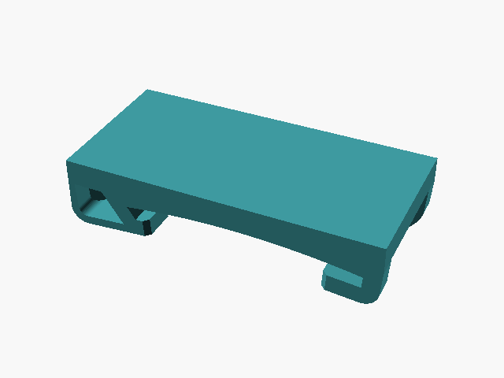<br>Clip mount | KLIPPT | exact | CC-BY-SA-4.0 | [KLIPPT by FH (printables.com/@bequ3) — cut at render time from the designer's own "cable clip small smooth" STL (unmodified): its lips, flange gap and lock as they are, the top filled flat. CC BY-SA 4.0 — see README "Licensing".](https://www.printables.com/model/424351-klippt-locking-cable-clip) | The counterpart of the KLIPPT base: fuse its flat top ("mount") onto a part, and the part slides onto a base like a clip. Lips down as "bot". plate is the solid above the clip's floor. On its own, print it on its end (slide direction up), the way KLIPPT prints its clips: the floor's arch then needs no bridge. |
| 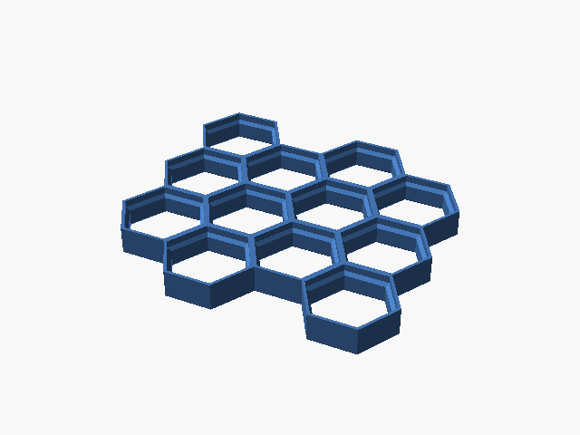<br>Wall panel | Honeycomb Storage Wall | exact | CC-BY-4.0 | [Honeycomb Storage Wall by RostaP; each cell is halfhex() from geru's 3d-scad-hsw-customizable (after Xander and EdwinEesting, CC-BY 4.0), vendored, laid out to match its own grid().](https://github.com/geru/3d-scad-hsw-customizable) | Front face on the bed (the 20mm openings), no supports. Columns are rows cells tall, every other one half a cell lower. flat_edges trims the panel to a rectangle with a flat wall all round, so panels butt together; the end columns are then half cells. "mount" is the back, against the wall. |
| 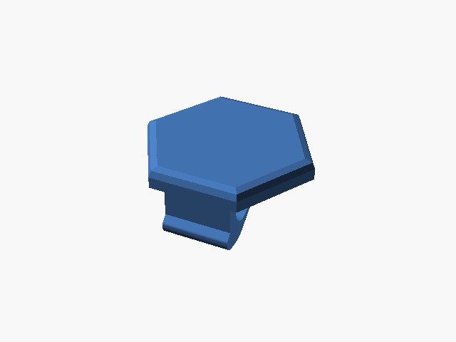<br>Insert | Honeycomb Storage Wall | exact | MIT | [geru's 3d-scad-hsw-clip (Hugh Kern, MIT, after KYZ's V2 clips), vendored](https://github.com/geru/3d-scad-hsw-clip) | Base on the bed, clip up, no supports. A one-way clip: push it into any HSW cell and its spring snaps it behind the lip; press the spring to take it out. The base's top is "mount", for fusing a hook or holder onto. base hex covers the cell, a millimetre short of its neighbours; rect is a bar across it. |
| 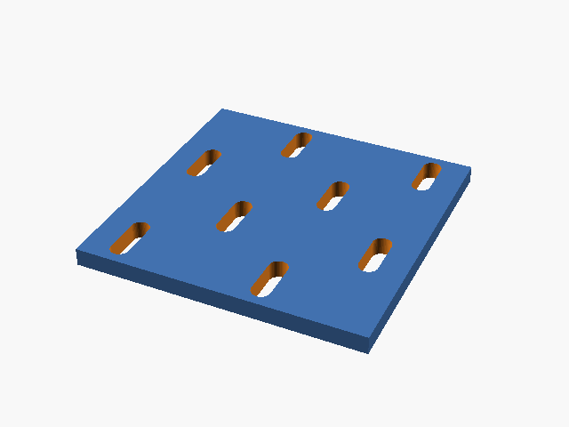<br>Board | Skådis | exact | MIT | [lib/skadis.scad: Skådis's 5 x 15mm slots in a checkerboard on a 20mm grid, checked against breckenedge's parametric-skadis-tower (CC-BY-SA 4.0, measured against, not vendored).](https://github.com/breckenedge/parametric-skadis-tower) | Flat on the bed, no supports. 5mm thick, slots 40mm apart along a row and rows 20mm apart, every other row shifted 20mm, as on a Skådis board; cols counts the slots in a row, in halves: 2.5 is five 20mm cells across, which makes the board symmetric left to right (a whole number leaves one side starting on a gap). The slots are cut 5.2mm wide, so moulded Skådis hooks go in. A board is exactly 2 x cols x rows 20mm cells, so boards butt together. "mount" is the back, against the wall. |
| 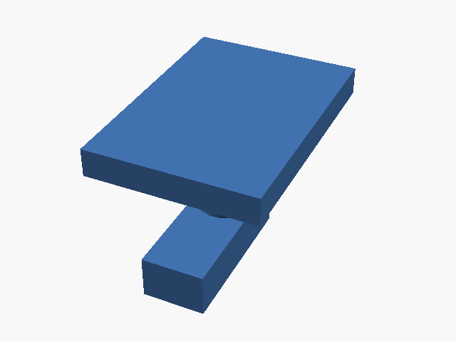<br>Peg | Skådis | exact | MIT | [lib/skadis.scad's hook tab, checked against this repo's Skådis board (itself checked against parametric-skadis-tower).](https://github.com/breckenedge/parametric-skadis-tower) | Print it on its side, a tab flat on the bed, so the layers run along the arm. Each tab goes straight through a slot, drops 6mm and hangs behind the board; lift it to take it off. pegs 2 puts two tabs 40mm apart, for two slots in a row, so the part cannot turn. The plate's front is "mount", for fusing a holder or shelf onto. |
| 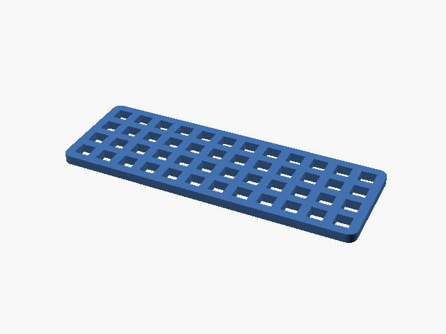<br>Grid | MOD-GRID | exact | CC-BY-NC-SA-4.0 | [MOD-GRID by 3dedc (TinyToolShop), MakerWorld model 2811701 — rebuilt from the designer's 4x12 grid STL, measured, and checked against it. CC BY-NC-SA 4.0 — see README "Licensing".](https://makerworld.com/en/models/2811701-mod-grid) | Flat on the bed, no supports. 5mm square holes on an 8mm pitch through a 3mm plate, cols across and rows up: a grid is exactly cols x 8 + 3 by rows x 8 + 3mm, so the designer's 12 x 4 is 99 x 35. Accessories plug into two neighbouring holes of a row. "mount" is the back, for fusing the grid onto a case or a lid. |
| 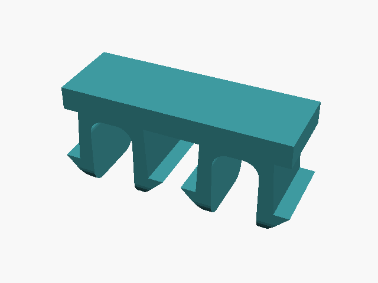<br>Pin | MOD-GRID | exact | CC-BY-NC-SA-4.0 | [MOD-GRID by 3dedc (TinyToolShop), MakerWorld model 2811701 — the designer's "Modular connector", with its pegs reshaped so their legs bend instead of breaking, and checked to fit the designer's grid. CC BY-NC-SA 4.0 — see README "Licensing".](https://makerworld.com/en/models/2811701-mod-grid) | The snap pin MOD-GRID accessories plug in with, for fusing onto any part so it plugs into a MOD-GRID grid; on the Bench it attaches with plate 0, the pegs straight on the part's face. pegs 2 is the 2x1 pin, for two neighbouring holes of a row; pegs 1 a single peg for one hole. rows repeats them in that many rows; depth is how deep each goes along its 5mm hole (4.8). On its own, plate puts a plate behind them, 14.6mm wide for two pegs, 6.6 for one. Each peg's legs bend 0.3mm to snap in and stay pressed on the hole's back edge, so the part sits flush and firm. Print the pegs on their side, their profile flat on the bed, as the designer does: turn the part, or the part it is fused onto, that way in the slicer. |
| 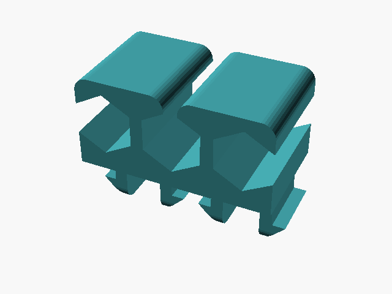<br>Bit holder | MOD-GRID | exact | CC-BY-NC-SA-4.0 | [MOD-GRID by 3dedc (TinyToolShop), MakerWorld model 2811701 — the designer's 4mm, 6mm and Leatherman flat bit holders, rebuilt from their v4 STLs, measured, and checked against them, on the reshaped pin of the MOD-GRID pin part. CC BY-NC-SA 4.0 — see README "Licensing".](https://makerworld.com/en/models/2811701-mod-grid) | Holds driver bits on a MOD-GRID grid: bit 4mm takes three 4mm hex precision bits, 6mm two 1/4" (6.35mm) hex bits, leatherman three Leatherman flat bits. The bits lie along the holder and slide in from an end. rows makes it that many grid rows long, 8mm and a pin each, to hold longer bits further along. Print it on its side, an end face on the bed, as the designer does; no supports. |
| 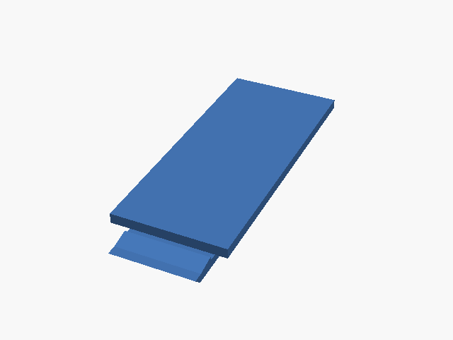<br>Spine | MOLLE | parametric | MIT | [lib/molle.scad, from the PALS grid as the webbing defines it: 25.4mm (1") rows with a 25.4mm gap, bar-tacked every 38.1mm (1.5"). No published geometry drawing or open model to check against.](https://en.wikipedia.org/wiki/Pouch_Attachment_Ladder_System) | Print it on its side, the profile flat on the bed, so the layers run along the tongue; PETG flexes better than PLA. Slide the tongue down behind rows rows of webbing from above, until the barb clicks in under the bottom row; press the tip back to take it off. cols 2 puts two tongues 38.1mm apart, for two columns, so the part cannot swing. webbing is the gap the webbing sits in: measure yours, and go tighter for a firmer grip. The plate's front is "mount". |
| 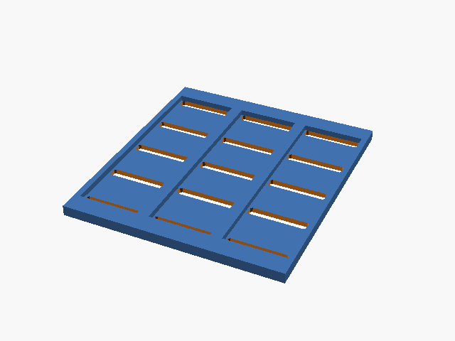<br>Panel | MOLLE | parametric | MIT | [lib/molle.scad: a laser-cut MOLLE panel's slits, every 25.4mm up and 38.1mm across, with a channel behind each column for the strap. No published geometry drawing or open model to check against.](https://en.wikipedia.org/wiki/Pouch_Attachment_Ladder_System) | Front down, ribs up, no supports. A pouch strap goes in at one slit, behind the strip, out at the next; the 30 x 5mm slits take a 1" strap, and channel is the room behind the skin for it to run in (0 for a bare slotted skin). rows counts strips, rows + 1 rows of slits. A panel is exactly cols x 38.1 by (rows + 1) x 25.4mm, so panels butt together. "mount" is the back. |
| 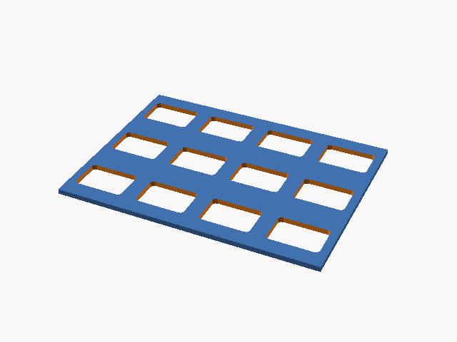<br>Rigid panel | MOLLE | parametric | MIT | [lib/molle.scad: rigid panels have no standard; the default opening is DV8 Offroad's published 1.5" x 1" (38.1 x 25.4mm), on PALS spacing up and a 12.7mm bar across. No open model to check against.](https://nomadicsupply.com/dv8-offroad-universal-molle-panel-23x15-unmp-06/) | Flat on the bed, no supports. Open windows that pouch straps wrap round and molle/insert plugs into. cols x rows openings, each open_w x open_h with open_r corners, centred in pitch_x x pitch_y cells: a panel is exactly cols x pitch_x by rows x pitch_y, so panels butt together. The openings are 0.5mm over the nominal 38.1 x 25.4, since printed holes come out narrow; a molle/insert at its defaults has 0.3mm a side. To match a truck panel, measure its openings and the distance between their centres. Mounting holes come from the Holes tab. "mount" is the back. |
| 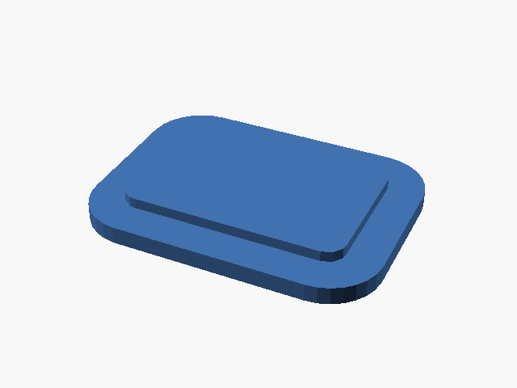<br>Panel insert | MOLLE | parametric | MIT | [lib/molle.scad's rigid-panel opening: a base plate behind the panel and a boss that fits the opening, a tenth under its nominal 38.1 x 25.4. Rigid panels have no standard, so the boss and the panel's thickness are parameters.](https://nomadicsupply.com/dv8-offroad-universal-molle-panel-23x15-unmp-06/) | Base down, boss up, no supports. boss_w x boss_h is the part that goes into the opening: 38 x 25.3 by default, a tenth under a real panel's nominal 1.5" x 1" and 0.3mm a side clear of molle/rigid_panel's printed opening. For another panel, measure its opening and take a little off. panel_t is its thickness (2mm for a typical steel panel, 4 for molle/rigid_panel's default); the boss stands 0.2mm short of the panel's front, so a bolted part clamps the panel. The base goes in from behind the panel. hole drills one centre through-hole; for heat-set inserts, nut traps or a grid of holes, use the Holes tab on the boss face. "mount" is the boss face. |
| 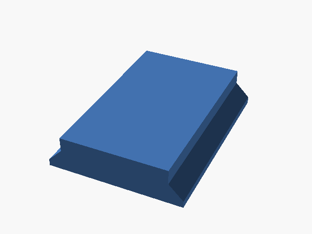<br>Arca-style plate | Camera | parametric | MIT | [lib/camera.scad, from Wimberley's published figure of the Arca-Swiss style dovetail (45° flanks, 38mm real and 41.9mm sharp width); flank height and thickness are this repo's choice. No published standard or open model to check against.](https://www.tripodhead.com/products/product-details2.cfm?product=arca-swiss-geometry) | Clamp face on the bed, flanks up, no supports. Makers differ by tenths of a millimetre: print a short one first and try it in your clamp. It is FIT_CLEARANCE a side narrower than nominal. screw cuts a slot for a 1/4"-20 camera screw, its head sunk from the clamp face; leave it off for a plate fused onto a part. "mount" is the top, where the camera or part sits. |
| 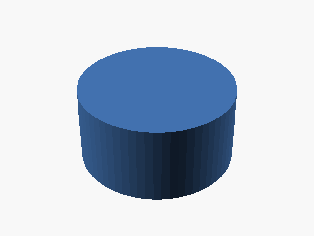<br>Tripod socket | Camera | exact | MIT | [BOSL2's UTS threads (threaded_rod() as a mask) and its hex nut table, vendored; checked with BOSL2's own screw and nut.](https://github.com/BelfrySCAD/BOSL2) | Mouth on the bed, no supports. A part fused onto its top ("mount") screws onto a tripod, light stand or camera rig. size 1/4 is the camera thread (1/4"-20), 3/8 the tripod-head one (3/8"-16). style thread prints the thread, opened up by FIT_CLEARANCE; nut is a pocket for a real hex nut, pressed in from the mouth, for weight a printed thread will not hold. |
| 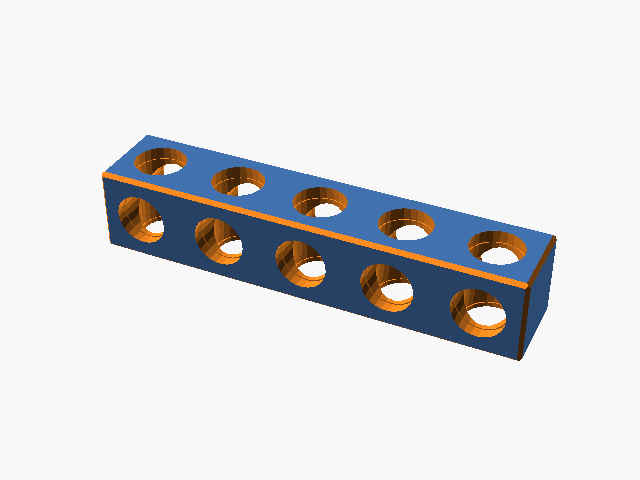<br>Beam | BitBeam | exact | BSD-3-Clause | [bitbeam-lib (ondratu, BSD-3-Clause), vendored; dimensions per bitbeam.cc](https://github.com/ondratu/bitbeam-lib) | Print flat, no supports. 4.8mm holes on an 8mm pitch through top and bottom, and through the sides with side_holes on. LEGO Technic-compatible. |
| 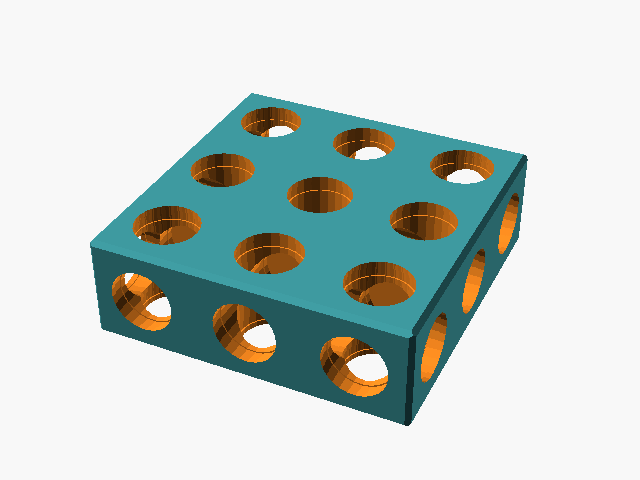<br>Plate | BitBeam | exact | BSD-3-Clause | [bitbeam-lib (ondratu, BSD-3-Clause), vendored; dimensions per bitbeam.cc. Nobody publishes a model of a plate like this, so there is no reference geometry to check against.](https://github.com/ondratu/bitbeam-lib) | Flat on the bed, no supports. Every hole is a real BitBeam hole, top and side. Side holes need height 1 (8mm); go thinner and turn side_holes off. Sizes are in 8mm units. |
| 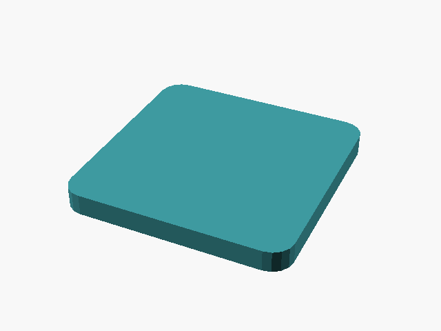<br>Flat plate | Basics | exact | MIT | Generic geometry, not tied to an external spec | Flat on the bed, no supports. Anchors on all six faces. 42 x 42mm with 4mm corners by default — one Gridfinity unit, so it lines up with a Gridfinity base or baseplate. |
| 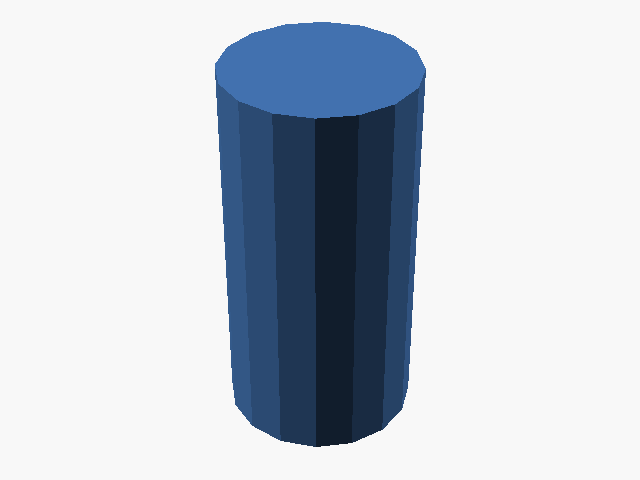<br>Round post | Basics | exact | MIT | Generic geometry, not tied to an external spec | Stands on its flat end ("bot"), no supports. |
| 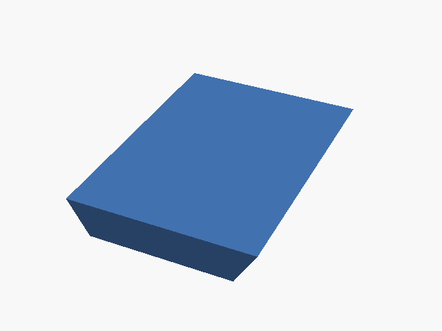<br>Dovetail rail | Basics | exact | MIT | Generic geometry, not tied to an external spec | Tip down, no supports. A generic dovetail, not DeckMate-compatible — import Mechanism's own model for that. |
| 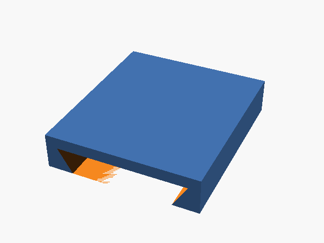<br>Dovetail channel | Basics | exact | MIT | Generic geometry, not tied to an external spec | Mouth down, no supports. Mates with the dovetail rail. |
| 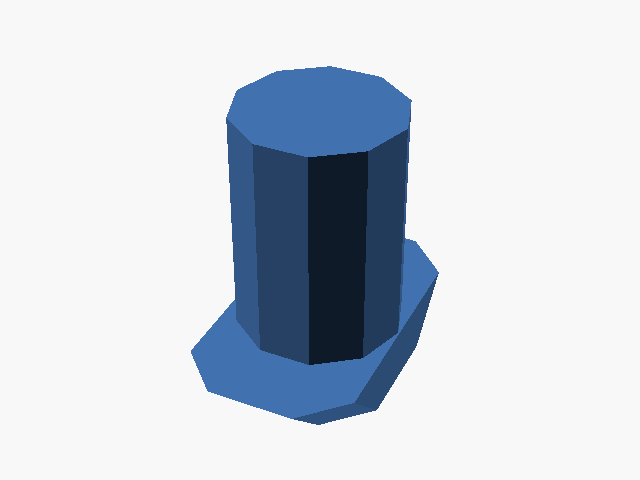<br>T-slot tab (hammer-head) | 2020 Extrusion | parametric | MIT | [Slot geometry measured off NopSCADlib's E2020t (GPL-3.0 — measured against, not vendored)](https://github.com/nophead/NopSCADlib) | Check EX_* in lib/constants.scad against your rail. tab_len up to 6mm drops into the slot face-first and twists to lock; a longer head feeds in from an open end. |
| 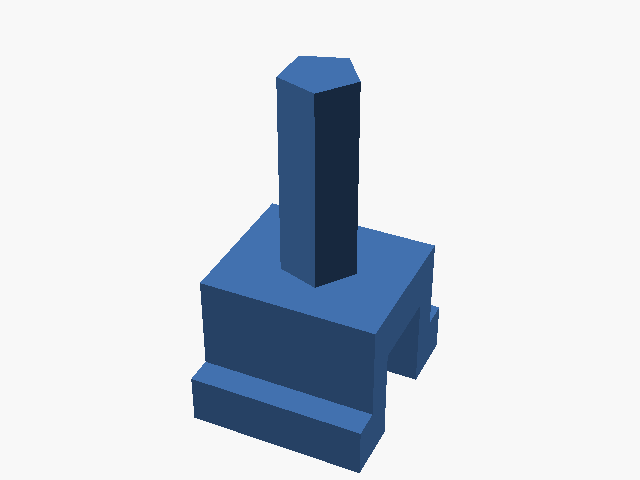<br>Snap-in clip | 2020 Extrusion | parametric | MIT | [Slot geometry measured off NopSCADlib's E2020t (GPL-3.0 — measured against, not vendored)](https://github.com/nophead/NopSCADlib) | Check EX_* in lib/constants.scad against your rail. Pushes straight into the slot mid-rail. Print in PETG or nylon so the legs can flex. |
| 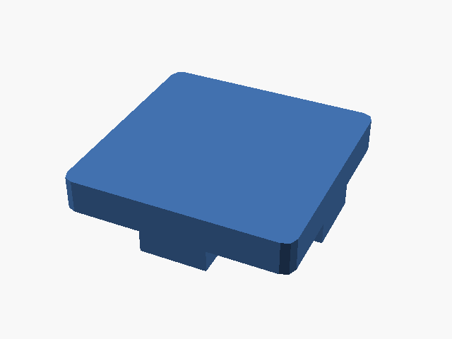<br>End-face plate | 2020 Extrusion | parametric | MIT | [Slot geometry measured off NopSCADlib's E2020t (GPL-3.0 — measured against, not vendored)](https://github.com/nophead/NopSCADlib) | Check EX_* in lib/constants.scad against your rail. Keys print face-down; the plate corners overhang them, so add a brim. |
| 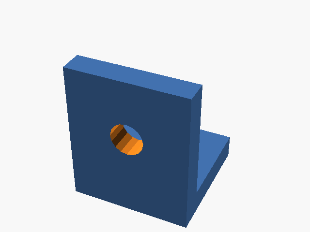<br>Corner bracket | 2020 Extrusion | parametric | MIT | [Slot geometry measured off NopSCADlib's E2020t (GPL-3.0 — measured against, not vendored)](https://github.com/nophead/NopSCADlib) | Check EX_* in lib/constants.scad against your rail. Base flange down; check the bore spacing against your T-nuts. |
| 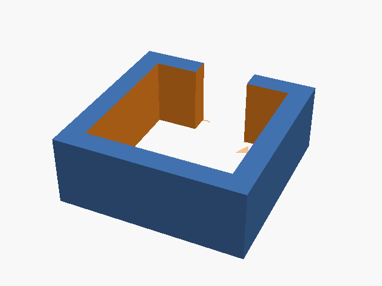<br>Profile C-clip | 2020 Extrusion | parametric | MIT | [Slot geometry measured off NopSCADlib's E2020t (GPL-3.0 — measured against, not vendored)](https://github.com/nophead/NopSCADlib) | Check EX_* in lib/constants.scad against your rail. Snaps over the outside of the profile; print with the ring axis vertical. |
| 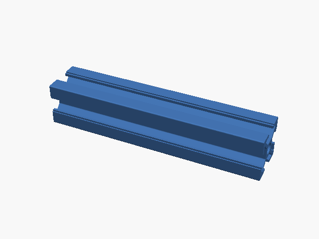<br>T-slot rail (printable stand-in) | 2020 Extrusion | parametric | Apache-2.0 | [AluminumExtrusionProfile (Jen Reed, Apache-2.0), vendored — its 2020 preset, which is close to but not E2020t; references.yaml records the gap.](https://github.com/ServerNinja/OpenSCAD_AluminumExtrusionProfile_Library) | A printable stand-in for real rail, for trying fittings and Bench layouts. Lies flat by default; "vertical" stands it on end. Slots along the top at 20mm pitch, on both ends and on the bottom. slot "v" is a V-slot profile. |
<!-- CATALOGUE:END -->

## User overrides

Saved overrides are a layer on top of the catalogue defaults, in the CLI (`foundry defaults`,
`foundry settings`) and in the web app. The resolution order and the commands:
[docs/OVERRIDES.md](docs/OVERRIDES.md).

## Accuracy

`references.yaml` compares each `exact` part against someone else's model of the same standard;
`make refs` fetches the sources and `make verify` runs them. What the shape and fit checks
measure: [docs/ACCURACY.md](docs/ACCURACY.md).

## Licensing

This repository's own files are MIT. Sixteen parts are not, and each catalogue entry says so:

| Parts | Licence | Why |
| --- | --- | --- |
| `opengrid/board`, `opengrid/snap` | **CC-BY-NC-SA 4.0** | They run `vendor/QuackWorks` code. NonCommercial applies to that use, ShareAlike to adaptations. Upstream licenses *generated tiles* CC-BY, so what you print is unrestricted. |
| `opengrid/openconnect`, `opengrid/multiconnect` | **CC-BY 4.0** | They run `vendor/opengrid-projects` code (the snap body; the openConnect head; the screw body's thread, `lib/ogthread.scad`, rewritten from it). Attribution to mitufy, nothing else. The Holes tab's openConnect slot and openGrid thread come from the same library; its MultiConnect slot and the MultiConnect head are this repo's MIT code. |
| `deckmate/innie`, `deckmate/outie`, `deckmate/universal`, the Holes tab's DeckMate socket | **CC BY-NC 4.0** | Mechanism's own STLs (the slim Outie is cut, at render time, from their Adhesive Puck STL), redistributed unmodified under the terms they publish their files under; the Holes tab's DeckMate socket (`lib/deckmate.scad`) is cut from the Innie at render time. NonCommercial applies to the files, to prints of them, to anything fused onto them, and to a part with a DeckMate socket cut into it. The screw pattern's dimensions in `lib/constants.scad` are facts; the generated flange is this repo's MIT code. |
| `klippt/base`, `klippt/clip_mount`, the Holes tab's KLIPPT channel | **CC BY-SA 4.0** | KLIPPT by FH ([printables.com/@bequ3](https://www.printables.com/@bequ3), [model 424351](https://www.printables.com/model/424351-klippt-locking-cable-clip)): the designer's own files (the base STEP tessellated, the screw base and "cable clip small smooth" STLs as published), redistributed unmodified with that credit; the clip mount and the Holes tab's KLIPPT channel (`lib/klippt.scad`) are cut from the clip at render time. ShareAlike applies to adaptations — a part with a base or a clip mount fused onto it, or a KLIPPT channel cut into it, is one, so share it under BY-SA. |
| `modgrid/grid`, `modgrid/connector`, `modgrid/bit_holder` | **CC BY-NC-SA 4.0** | MOD-GRID by 3dedc (TinyToolShop, [MakerWorld model 2811701](https://makerworld.com/en/models/2811701-mod-grid)): rebuilt from measurements of the designer's own STLs (none of which ships here), so adaptations of the design under its terms. NonCommercial applies to the files, to prints of them and to a part with a MOD-GRID pin fused onto it; ShareAlike to adaptations — such a part is one, so share it under BY-NC-SA. |
| `hsw/wall` | **CC-BY 4.0** | It runs `vendor/hsw-customizable` code (Xander, EdwinEesting, geru). Attribution, nothing else. |
| `bitbeam/beam`, `bitbeam/plate` | **BSD-3-Clause** | Call into `vendor/bitbeam-lib`. Permissive, just not MIT. |
| `extrusion2020/rail` | **Apache-2.0** | Calls into `vendor/AluminumExtrusionProfile`. Permissive, just not MIT. |
| everything else | MIT | — |

BitBeam's own site (bitbeam.cc) is CC-BY-NC-SA and its STL pack is not used; the geometry comes
from `bitbeam-lib`, a separately and permissively licensed implementation by the same author, and
from `technic.scad` for the pin and axle (a BitBeam pin *is* a LEGO Technic pin). NopSCADlib (GPL)
is measured, never called or vendored. The Honeycomb Storage Wall is RostaP's design, whose own
models are CC BY-NC; neither is used here. The wall and the insert run two OpenSCAD
implementations their authors publish under CC-BY 4.0 and MIT. `openscad-wasm` bundles OpenSCAD itself (GPL-2.0) as an
external tool the browser runs, the same way the CLI shells out to `openscad`. The web app's STEP
reader, `occt-import-js`, is Open CASCADE Technology (LGPL-2.1 with the OCCT exception) compiled
to WebAssembly and loaded as a separate file only when a STEP file is imported.

## Contributing

Start with [AGENTS.md](AGENTS.md): how the pieces fit together, which command proves which kind of
change (`make check` is the minimum before every commit), and the rules that are easy to break.

## Repo layout

```
lib/             constants, slot/joint conventions, shared helpers
parts/           one .scad per part, grouped by system
assemblies/      example compositions of two or more parts
cli/             foundry.py — render/build/preview/goldens/readme CLI
tools/           reference cache + the comparison engine behind `make verify`
references.yaml  what each part is checked against, and how
tests/           soundness, anchors, recorded dimensions, reference checks
web/             browser app (openscad-wasm), and the website around it: landing page, guides
docs/            guides (also published on the website) and packaging notes
vendor/          upstream implementations, as git submodules
refs/            reference cache (gitignored)
```
